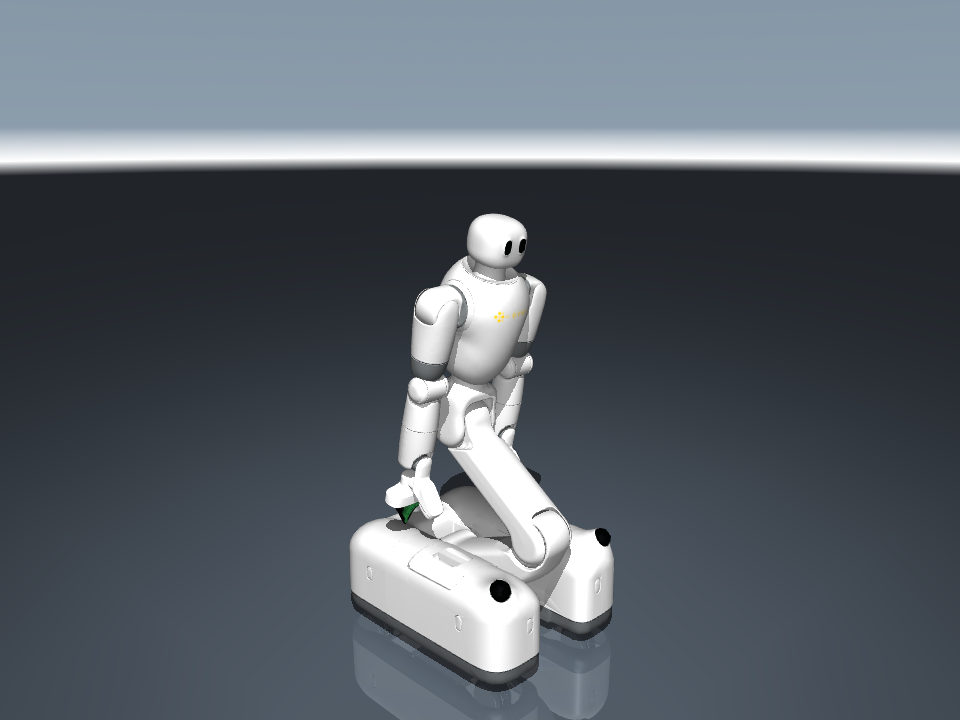

# dyna robotics Robot Descriptions

Robot models from **dyna robotics**.

## Taku

[Taku](dyna_taku/README.md) is a mobile dual-arm robot with DynaClaw grippers.
The MuJoCo model includes visual meshes, materials, sensor mounting frames,
simplified collision geometry and a home keyframe.



Open `dyna_taku/scene.xml` in MuJoCo:

```bash
python -m mujoco.viewer --mjcf dyna_taku/scene.xml
```

## License

Copyright (c) 2026 dyna robotics.

Models and assets are released under the [Apache License 2.0](LICENSE).
