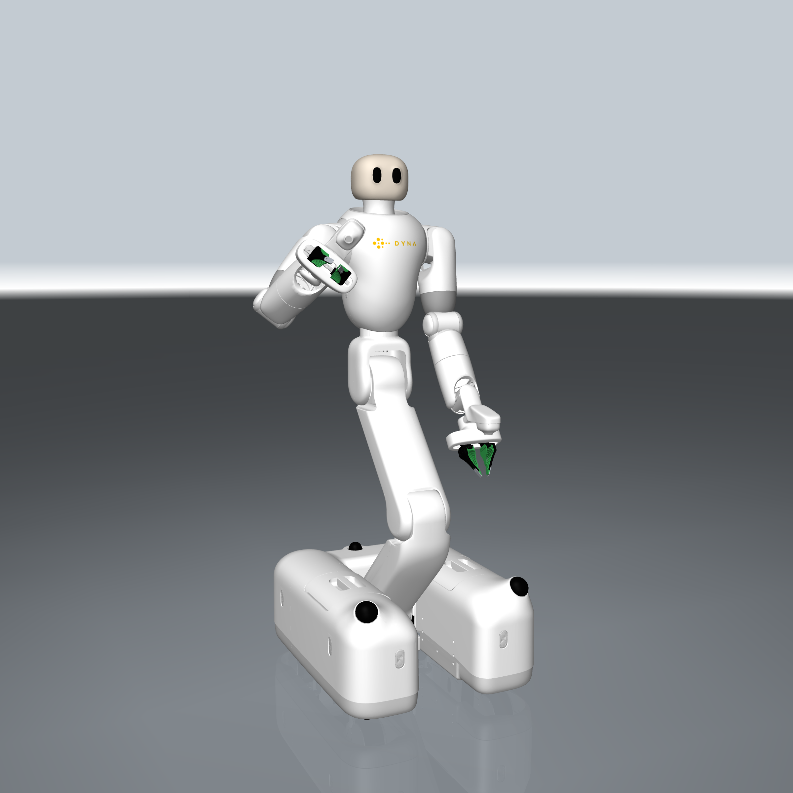

# dyna robotics Robot Descriptions

Robot models from **dyna robotics**.

## Taku

[Taku](dyna_taku/README.md) is a mobile dual-arm robot with DynaClaw grippers.
The MuJoCo model includes visual meshes, materials, sensor mounting frames,
simplified collision geometry and a home keyframe.



The [DynaClaw finger assembly](dyna_claw/README.md) can also be viewed and edited
independently; Taku includes generated left/right instances of that model.

Open `dyna_taku/scene.xml` in MuJoCo:

```bash
python -m mujoco.viewer --mjcf dyna_taku/scene.xml
```

The [Taku USD package](dyna_taku/usd/README.md) targets Isaac Sim with Newton /
MuJoCo Warp, with reproducible dynamics and appearance comparisons.

## License

Copyright (c) 2026 dyna robotics.

Models and assets are released under the [Apache License 2.0](LICENSE).
