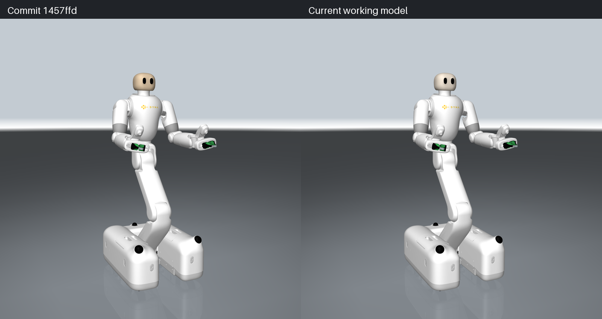
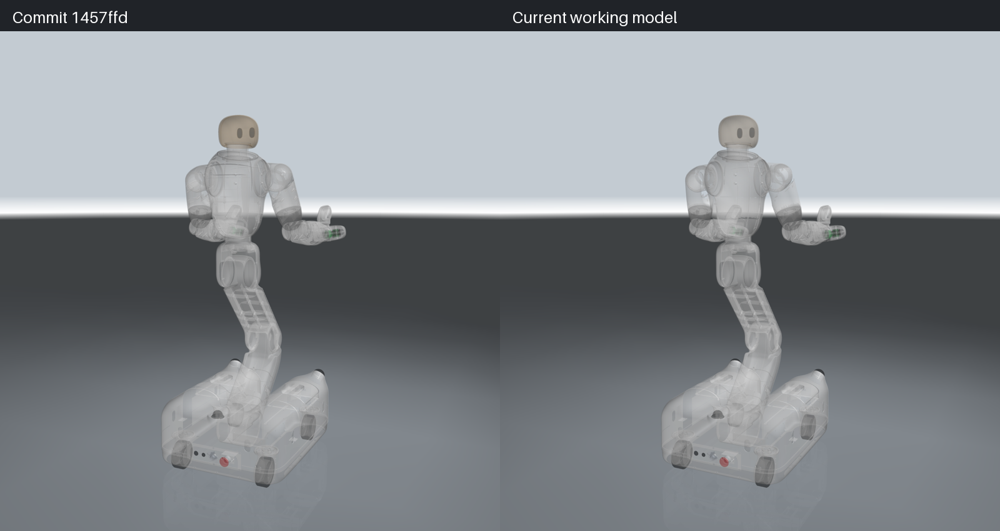
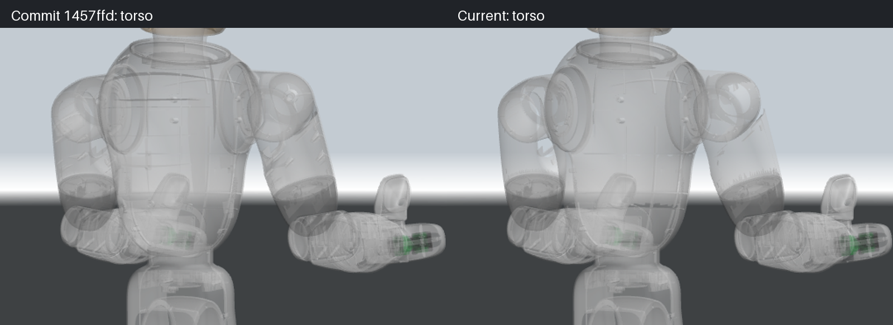
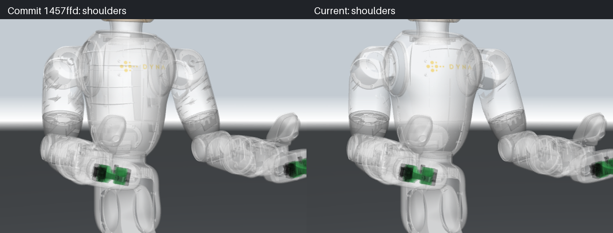
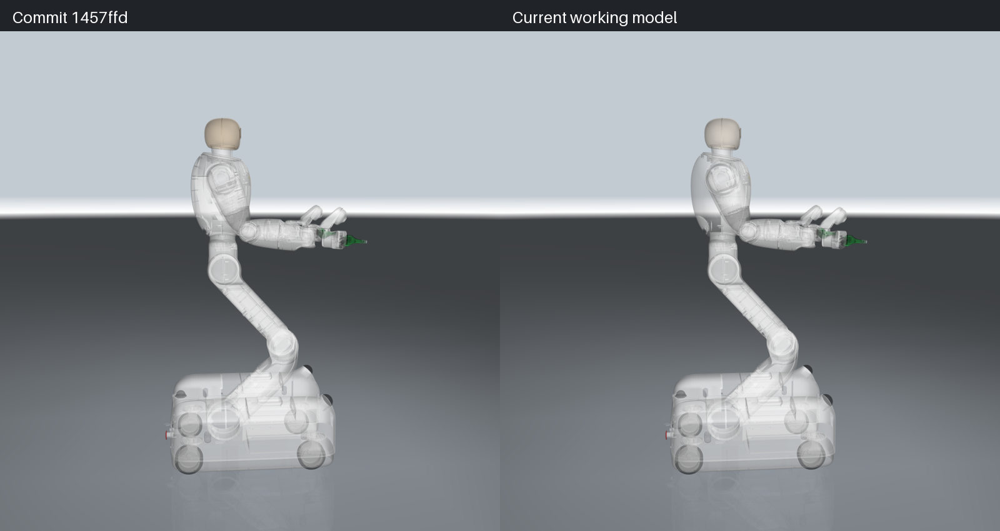

# Taku visual cleanup review

The previous model contained internal ribs, walls and mechanical details that cluttered transparent inspection. This update removes selected internal faces from 30 visual OBJ files, using the original June CAD assembly to guide selection. Retained faces keep their original vertex positions, UVs and normals; no alternate shell shape is substituted.

| Taku assets/meshes OBJ files | Before (1457ffd) | After |
| --- | ---: | ---: |
| Files | 101 | 101 |
| Triangles | 610,873 | 551,458 |
| Size (decimal MB) | 65.50 | 58.43 |

59,415 triangles removed (9.73%); mesh bytes reduced by 10.80%. These counts cover `dyna_taku/assets/meshes/*.obj`, not the separate DynaClaw assets. No rendering-speed improvement is claimed.

## Changes and limits

- Clean selected torso/back, shoulder, upper-arm, forearm/wrist, head, folding and lower-AGV visual surfaces.
- Preserve exterior color coverage, including the older-gray elbow bowl, white lower cylinder, and lighter-gray adjacent parts. Restore exposed boundary faces where removal caused a color regression.
- Intentionally lighten only the head: HSB(34, 25, 89) → HSB(34, 12, 93), approximately RGB(227, 202, 170) → RGB(237, 225, 209).
- Regenerate the greeting preview at 2400 × 2400. Its pose and lighting are presentation settings, not changes to the model's home pose.
- Keep exposed mechanisms, uncertain shell boundaries and functional gripper/sensor details. Removing these could expose gaps or alter the silhouette at other joint poses. This is conservative visual cleanup, not complete removal of all internals; the meshes are not promised to be watertight manufacturing solids.
- Leave joint definitions, masses/inertias, transforms, actuators, home keyframe, collision geometry and contact settings unchanged. No Menagerie files are part of this update.

## Before / after

Left: previous committed model. Right: updated model. Each pair uses identical camera, pose and lighting.







## Validation

- All six existing `dyna_claw.test_model` tests pass with MuJoCo 4.0.1.
- `verification.json` records original-face subset checks for all 30 changed meshes, unchanged physical/contact parameters and unchanged material values except the requested head color.
- A 1,000-step home-state regression produced identical qpos/qvel and no MuJoCo warnings. This checks that visual edits did not change this rollout; it is not a new dynamic grasp benchmark or exhaustive pose/collision test.
- Solid and transparent renders inspected from four viewpoints/poses. Earlier color-coverage inspection sampled 24 views; it found no broad interior color-region changes after restoring affected boundaries. Sampled images do not prove every possible articulated pose is artifact-free.

### Reproduce comparisons

Copy `render.py`, `compare.py` and `verify.py` into an empty working directory outside the repository. In that directory, create `baseline/` and `candidate/`, each containing `dyna_taku/` and `dyna_claw/`. Populate baseline from commit `1457ffd57d3e474870dfe985e7d40ae37e53f76d` and candidate from this PR.

With Python 3.11, MuJoCo 4.0.1, NumPy and Pillow installed:

```sh
python verify.py
python render.py baseline
python render.py candidate
python compare.py
```

Rendering uses EGL. Run the existing tests from the repository root with `python -m unittest dyna_claw.test_model`. Do not copy the baseline/candidate model snapshots into the repository.
