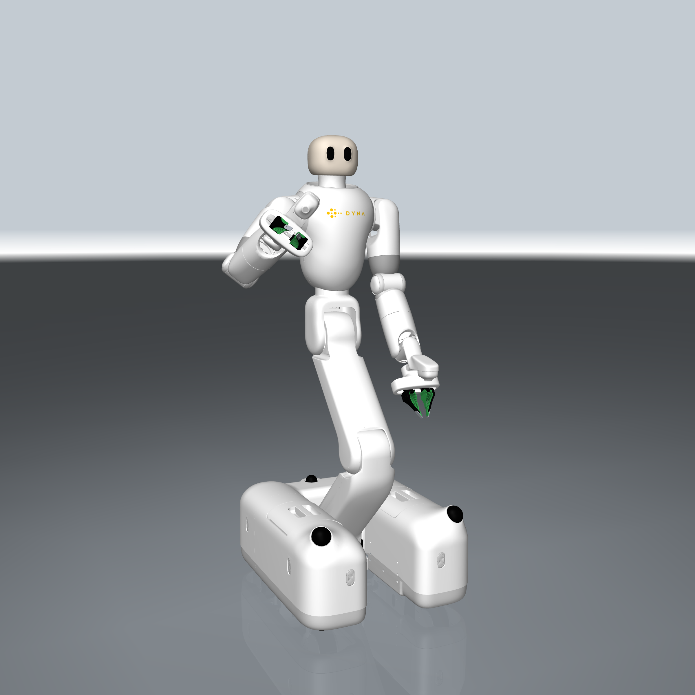

# dyna Taku Description (MJCF)

Tested with MuJoCo 3.3.7 and 3.4.1.

## Overview

This package contains a simplified MuJoCo model of **Taku**, a mobile dual-arm
robot developed by **dyna robotics**, with DynaClaw grippers.

The robot has four steered wheels, four waist joints, three head joints,
two seven-joint arms and parallel grippers, with 31 actuators.
Camera, lidar and IMU mounting frames are included.

All visual and collision meshes use OBJ format. Gripper collision geometry uses
native boxes, tip capsules, and small convex meshes, independently of the visual meshes.

The [standalone DynaClaw model](../dyna_claw/README.md) is the source for both
grippers. Its generated files in `gripper/` are included by `taku.xml`.

Open `scene.xml` in MuJoCo; `taku.xml` contains the robot model and `home` keyframe.

## Isaac Sim / USD

An [additional USD model](usd/README.md) is available for **Isaac Sim 6.2 with
Newton and its MuJoCo Warp solver**. It includes a dedicated hero image, startup
script and [MuJoCo/Isaac validation report](usd/validation/README.md).
Use the documented Newton configuration; PhysX has not been validated.

## License

Copyright (c) 2026 dyna robotics.

This model, including its meshes and texture, is released under the
[Apache License 2.0](LICENSE).
