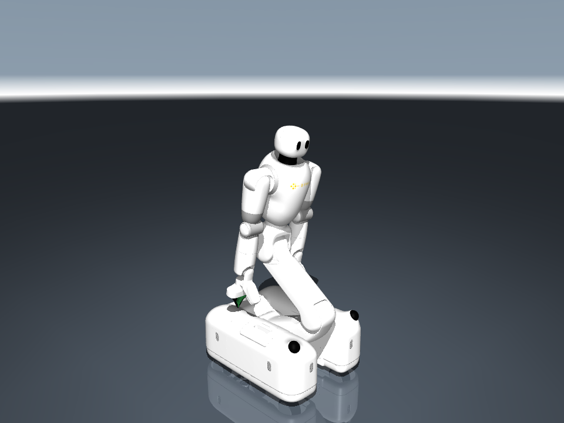

# dyna Taku Description (MJCF)

Tested with MuJoCo 3.3.7 and 3.4.1.

## Overview

This package contains a simplified MuJoCo model of **Taku**, a mobile dual-arm
robot developed by **dyna robotics**, with DynaClaw grippers.

The robot has four steered wheels, four waist joints, three head joints,
two seven-joint arms and parallel grippers, with 31 actuators.
Camera, lidar and IMU mounting frames are included.

Open `scene.xml` in MuJoCo; `taku.xml` contains the robot model and `home` keyframe.

## License

Copyright (c) 2026 dyna robotics.

This model, including its meshes and texture, is released under the
[Apache License 2.0](LICENSE).
