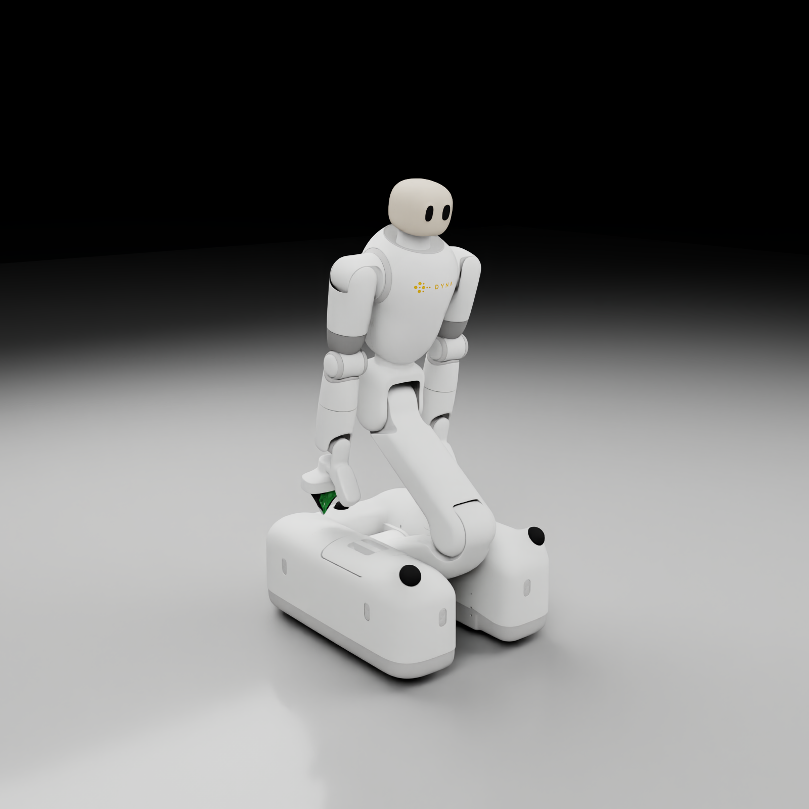

# Taku USD — Isaac Sim with Newton



USD conversion of the adjacent Taku MJCF, with the same visual meshes, color
partitions, chest texture, joints, inertials, actuators and collision geometry.
This is an additional format; the existing MuJoCo model is unchanged.

**Use Isaac Sim 6.2 with the Newton backend and its MuJoCo Warp solver.**
That is the tested configuration. PhysX is not validated for this asset and does
not interpret all of its Newton/MuJoCo-specific attributes. Opening a USD file
alone does not select the physics engine.

- `taku.usda`: robot physics asset, original floor and home keyframe.
- `scene.usda`: lit home-pose presentation for inspecting appearance. Its
  presentation transforms are not intended for stepping physics.
- `layers/`: referenced geometry, material, texture and physics data. Keep it
  beside the entry files.
- `simulate.py`: explicit Newton/MuJoCo Warp startup and home control.
- `validation/`: reproduction scripts, environment lock, measured results and
  MuJoCo/Isaac comparison images.

## Run

Use the Python environment described in [validation/README.md](validation/README.md).
From the repository root:

```bash
python dyna_taku/usd/simulate.py --gpu 0
# Bounded, off-screen smoke run:
python dyna_taku/usd/simulate.py --gpu 0 --headless --seconds 2
```

The script directly steps Newton and holds the home control targets. Do not also
start the timeline: that would introduce a second stepping clock. The default
0.5 ms timestep is recommended for close-contact comparisons; the source asset
retains the MJCF's 1 ms timestep. The script does not save changes to the USD.

## What is aligned

The runtime uses native MuJoCo contacts, MultiCCD, `implicitfast`, the elliptic
friction cone, and the source contact, friction, actuator and inertial parameters.
Explicit zero armature values prevent Newton defaults from adding inertia.
A collision-only layer preserves the source MuJoCo compiled hull vertices, avoiding
different hull simplification in the importer while retaining the visual meshes.
The soft finger pads retain the MJCF's compliant contact parameters; they are not
volumetric deformable bodies.

USD is data, not an embedded engine. Isaac provides RTX rendering; Newton loads
the USD and delegates dynamics to MuJoCo Warp. MuJoCo CPU and GPU Warp are not
bitwise equivalent, and small contact differences can grow after release.
See the [validation report](validation/README.md) for measured errors, test scope
and limitations. Rendering uses different lighting/shading from MuJoCo OpenGL;
colors and textures are preserved, but pixels are not expected to match.

Apache-2.0; see [LICENSE](../LICENSE).
