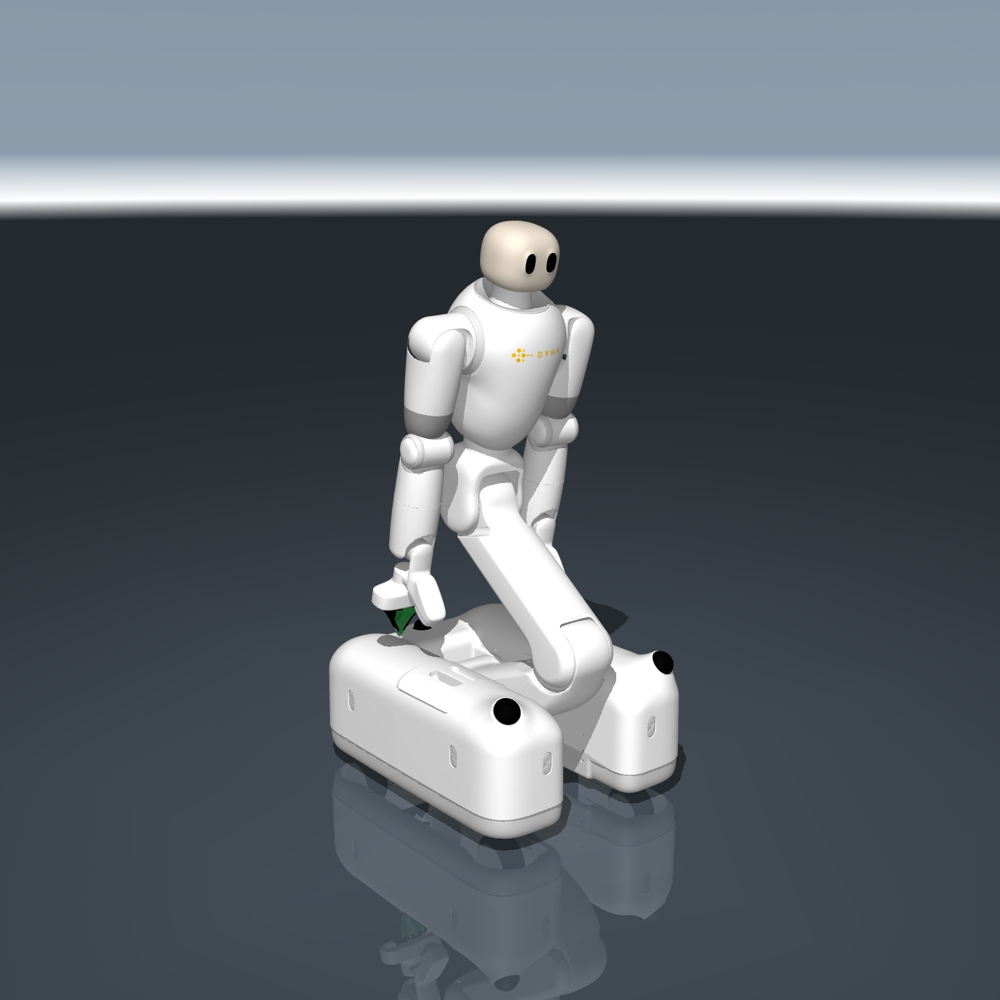
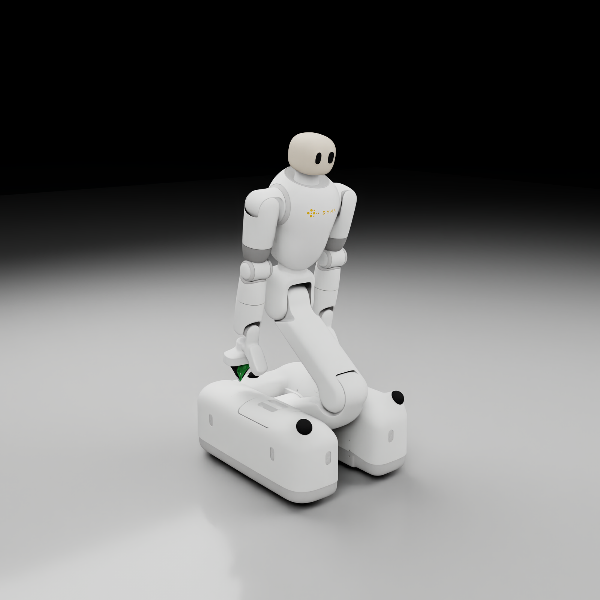
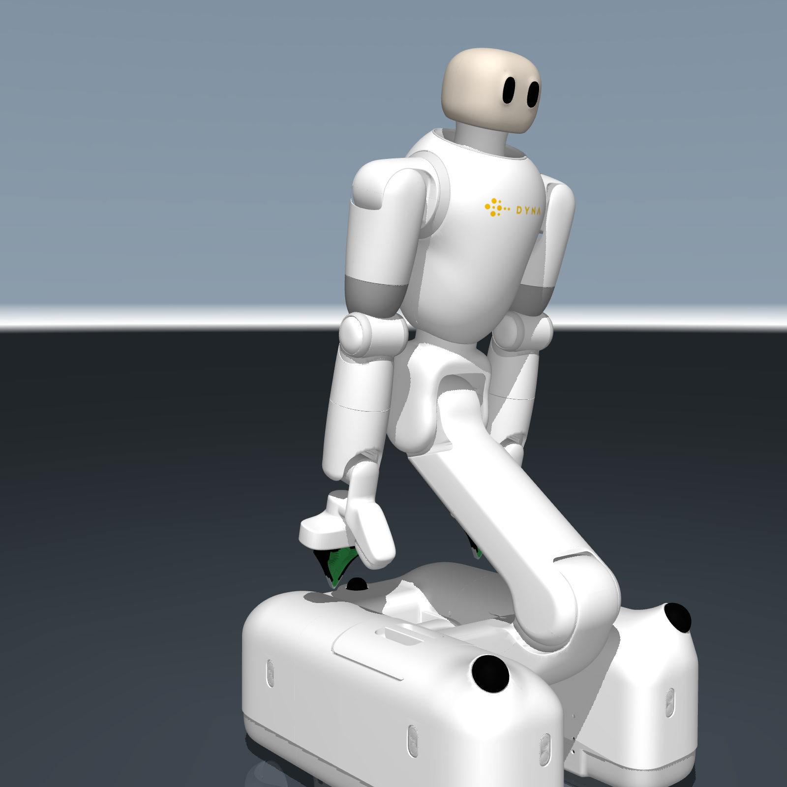
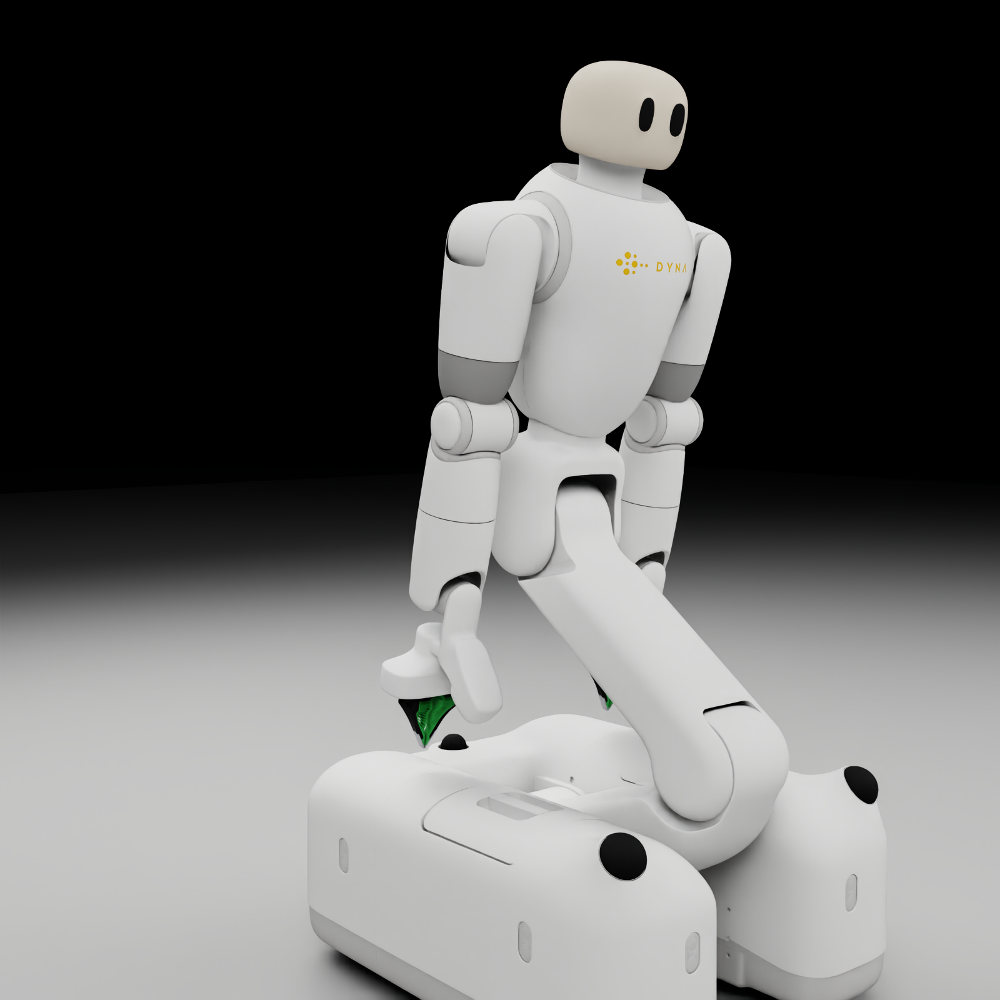
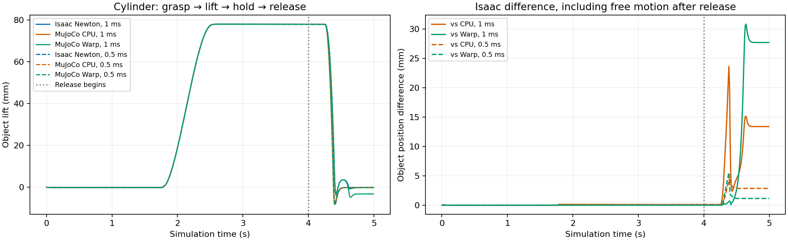
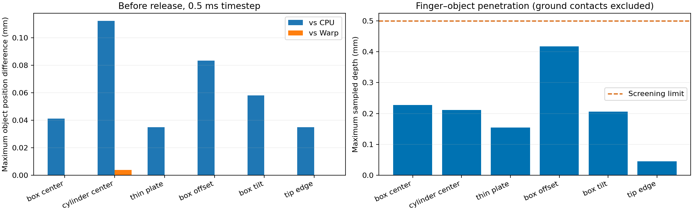
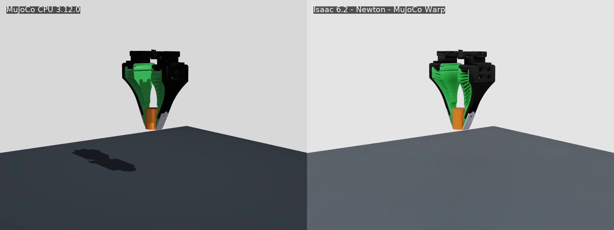

# MuJoCo / Isaac Newton validation

Validated on 2026-11-27 against source commit
`ccd4f132fcbd740433713bb23b12f3023acf5615`.

**Use Newton's MuJoCo Warp solver in Isaac Sim.** PhysX is not covered by these
results. USD stores geometry/materials and physics descriptions; it does not
contain or automatically select a physics engine. The provided startup script
selects the tested backend explicitly.

## Environment

| Component | Tested version/configuration |
| --- | --- |
| OS | Ubuntu 22.04.5 LTS, Python 3.12.11 |
| Isaac Sim | 6.2.0.0 |
| Newton | 1.6.1, Isaac's actual `NewtonStage` backend |
| MuJoCo CPU / MuJoCo Warp | 3.12.0 / 3.12.0 |
| NVIDIA Warp | 1.19.0, stable release |
| GPUs | 2 × RTX 4090 D, 24 GB each; dynamics on GPU 1, final RTX renders on GPU 0 |
| Driver | 580.159.03 |
| C++ runtime | Isolated conda-forge libstdcxx-ng 13.2.0; system libraries unchanged |
| MJCF → USD converter | 0.10.0, separate Python 3.11 environment |
| Asset audit | MuJoCo 4.0.1 + usd-core 25.11, separate environment |

The dynamics comparison uses Isaac's pinned **3.12.0** MuJoCo/Warp versions for
all three paths, not the separate 4.0.1 asset-audit environment. See
[environment.json](results/environment.json) and the
[Isaac dependency lock](requirements-isaac.lock.txt).

## Appearance

The source visual meshes and their color partitions are retained. Numeric checks
verify sRGB → linear RGB conversion of the materials, and the chest texture has
an identical SHA-256 hash. The yellow logo, warm head, white/gray shells, green
pads, black gripper parts, silver parts and red emergency stop are retained.
No original MJCF, mesh, texture, material or existing hero image is changed.

These images use the same home pose and camera position/FOV. Lighting is adjusted
for each renderer; MuJoCo OpenGL and Isaac RTX/PBR do not have identical shading,
reflections or exposure. This is not a pixel-equality or rendering-speed benchmark.

| MuJoCo OpenGL | Isaac Sim RTX |
| --- | --- |
|  |  |
|  |  |

[Color/texture and asset-resolution checks](results/asset.json).
The new USD hero image is [../preview.png](../preview.png).

## Dynamics alignment

All paths use the same source controls, masses, inertia, contact parameters and
actuator gains/limits. The independent gripper uses a moving lift joint, free
objects and gravity. Fingers close via actuator commands; no object is attached
or teleported during simulation.

The Isaac configuration uses native MuJoCo contacts (`use_mujoco_contacts=True`),
MultiCCD, `implicitfast`, elliptic friction cones, `impratio=10`, and the source
solver tolerances. We recommend **0.5 ms** for contact-sensitive comparisons.
The USD asset retains the source 1 ms setting; the runtime/test explicitly sets
the selected timestep for every backend.

Compatibility work:

1. Preserve explicit zero joint armature rather than accepting Newton's default
   0.1 on an unauthored joint. This mattered for the test lift joint.
2. Preserve physics-material friction for the native MuJoCo USD decoder, Z-up,
   metre units, world-anchored joints and the original home keyframe. Avoid
   conflicting full/diagonal inertia descriptions.
3. **Preserve MuJoCo's compiled collision hulls.** Recomputing a 64-vertex hull in
   another library can select different support vertices. A collision-only USD
   layer stores the source MuJoCo hulls, with no change to visual meshes or body
   parameters. Across 49 mesh colliders and 1,030 sampled directions, the maximum
   imported support-boundary discrepancy is **0.000676 mm**.

The two-second whole-robot simultaneous-motion comparison improved from about
**7.49 mm** maximum body-position error to **0.00084 mm** versus MuJoCo Warp after
preserving those hulls. Versus CPU MuJoCo the final maximum is **0.00171 mm**.
This is a small-motion test from home, not an exhaustive joint-limit sweep.
See [before/after measurements](results/alignment_changes.json),
[robot trajectories](results/robot_motion.csv), and
[hull checks](results/collision_hulls.json).

## Gripper results

Six cases at both 1 ms and 0.5 ms: centered box, cylinder, thin plate, offset box,
15-degree tilted box and fingertip-edge grasp. Each runs five simulated seconds:
close, lift 80 mm, hold, release. Objects are 50 g. Both lower timestep and the
source timestep are evaluated with identical inputs across all engines.

**12/12 cases passed** the screening criteria: finite positions, successful
lift/hold/release, sampled finger–object penetration below 0.5 mm, and maximum
pre-release object-position error below 1 mm versus both reference paths.
The lift/hold/release check requires lift >60 mm, hold drift <2 mm and release
drop >50 mm. Ground contacts are excluded from the finger penetration statistic.

| Case | Step (ms) | Lift (mm) | Hold drift (mm) | Finger penetration (mm) | Pre-release error vs CPU (mm) | vs Warp (mm) |
| --- | ---: | ---: | ---: | ---: | ---: | ---: |
| box_center | 1 | 77.981 | -0.030 | 0.167 | 0.0698 | 0.00000 |
| cylinder_center | 1 | 78.079 | -0.036 | 0.193 | 0.1333 | 0.00622 |
| thin_plate | 1 | 76.699 | -0.030 | 0.071 | 0.0698 | 0.00000 |
| box_offset | 1 | 77.824 | -0.030 | 0.218 | 0.0844 | 0.00001 |
| box_tilt | 1 | 77.976 | -0.032 | 0.169 | 0.0698 | 0.00007 |
| tip_edge | 1 | 79.771 | -0.030 | 0.033 | 0.0698 | 0.00003 |
| box_center | 0.5 | 77.951 | 0.007 | 0.227 | 0.0412 | 0.00000 |
| cylinder_center | 0.5 | 78.001 | -0.067 | 0.211 | 0.1122 | 0.00379 |
| thin_plate | 0.5 | 76.682 | 0.007 | 0.154 | 0.0349 | 0.00000 |
| box_offset | 0.5 | 78.013 | 0.007 | 0.418 | 0.0834 | 0.00000 |
| box_tilt | 0.5 | 77.941 | -0.067 | 0.206 | 0.0580 | 0.00005 |
| tip_edge | 0.5 | 79.787 | 0.007 | 0.045 | 0.0349 | 0.00003 |

At 0.5 ms, the largest pre-release error is **0.113 mm vs CPU** and
**0.0038 mm vs Warp**. Maximum sampled finger penetration is **0.418 mm**.
Recorded CPU MuJoCo runtime warning counts were zero.

After release, cylinder rolling/impact is sensitive to small contact differences.
Across the full five-second trajectories, the largest discrepancy is **5.54 mm
vs Warp / 4.41 mm vs CPU at 0.5 ms**, versus **30.84 / 23.62 mm at 1 ms**.
These differences are reported, not hidden by stopping the comparison at release.
They do not invalidate the demonstrated grasp/hold/release outcomes, but they
rule out a claim of universal or bitwise equivalence. Individual contact-point
force peaks are also recorded; changing contact manifolds can redistribute force
among points, so per-point peaks are not asserted equal.




[Raw metrics](results/contact_results.json) include opening differences, actuator
force peaks, per-contact force peaks and penetration. CSV trajectories are in
`results/`. GPU/CPU numerical differences are expected: GPU Warp uses float32,
while CPU MuJoCo uses float64. The runtime also reports that capsule/mesh pairs
have at most one contact even with MultiCCD enabled. No contact parameter was
artificially tuned to hide these backend differences.

### Simulation comparison

[Watch the five-second MuJoCo / Isaac grasp comparison](grasp_comparison.mp4).
The video replays recorded physics states at 30 fps; rendering does not generate
or constrain the movement. Camera position and timing match. Neutral background
and render-only prop shaders make the black gripper and test object visible.



## Other checks and limits

- Existing repository suite: **8 tests and 182 subtests passed**, including
  generated gripper synchronization, static geometry and dynamics regressions
  (separate MuJoCo 4.0.1 environment).
- Portable asset composition and texture resolution pass. Native USD round trip
  retains 40 qpos, 39 velocities, 31 actuators and 2 gripper coupling constraints.
- `simulate.py` completed 2.013 simulated seconds with finite state and Fabric
  updates, using the submitted USD and the documented Newton configuration.
- Soft pads use compliant rigid-contact parameters, not a deformable continuum.
- Full-robot object manipulation, an exhaustive joint-range collision sweep,
  heavier real motor grasps and hardware-calibrated force matching are outside
  this validation. No RTX throughput improvement is claimed.

## Reproduce

Use three isolated environments. Do not install `usd-core` in the converter's
`usd-exchange` environment; their binary USD distributions conflict.
Commands below assume execution from the repository root. A modern GCC 13 C++
runtime is required by Isaac; on the tested Ubuntu 22.04 machine a separate
conda-forge libstdcxx-ng 13.2.0 library directory was placed in `LD_LIBRARY_PATH`.

```bash
# Isaac runtime / the CPU and GPU physics comparisons (Python 3.12).
uv venv /tmp/taku-isaac --python 3.12
uv pip install --python /tmp/taku-isaac/bin/python \
  -r dyna_taku/usd/validation/requirements-isaac.lock.txt \
  --extra-index-url https://pypi.nvidia.com

# Converter (Python 3.11), isolated from usd-core.
uv venv /tmp/taku-convert --python 3.11
uv pip install --python /tmp/taku-convert/bin/python mujoco-usd-converter==0.10.0

# USD inspection/compatibility authoring (Python 3.11).
uv venv /tmp/taku-audit --python 3.11
uv pip install --python /tmp/taku-audit/bin/python \
  'mujoco[usd]==4.0.1' usd-core==25.11 numpy scipy pillow pytest

export OMNI_KIT_ACCEPT_EULA=YES
# If needed, set LD_LIBRARY_PATH to an isolated GCC 13 runtime library directory.
```

Run the provided asset and tests:

```bash
/tmp/taku-audit/bin/python dyna_taku/usd/validation/check_asset.py
/tmp/taku-audit/bin/python dyna_taku/usd/validation/build_usd.py \
  --converter /tmp/taku-convert/bin/mujoco_usd_converter \
  --output /tmp/taku-check --fixtures
/tmp/taku-isaac/bin/python dyna_taku/usd/validation/compare_grasps.py \
  --work-dir /tmp/taku-check --gpu 0
/tmp/taku-isaac/bin/python dyna_taku/usd/validation/compare_robot.py \
  --work-dir /tmp/taku-check --gpu 0
/tmp/taku-isaac/bin/python dyna_taku/usd/simulate.py --gpu 0 --headless --seconds 2
```

To regenerate the shipped robot layers after an MJCF change:

```bash
/tmp/taku-audit/bin/python dyna_taku/usd/validation/build_usd.py \
  --converter /tmp/taku-convert/bin/mujoco_usd_converter \
  --output /tmp/taku-rebuild --install-robot
/tmp/taku-isaac/bin/python dyna_taku/usd/validation/export_collision_hulls.py \
  --output /tmp/taku-check/compiled_hulls.json
/tmp/taku-audit/bin/python dyna_taku/usd/validation/apply_collision_hulls.py \
  --hulls /tmp/taku-check/compiled_hulls.json
/tmp/taku-isaac/bin/python dyna_taku/usd/validation/compare_robot.py \
  --work-dir /tmp/taku-check --gpu 0
/tmp/taku-isaac/bin/python dyna_taku/usd/validation/check_collision_hulls.py \
  --runtime-model /tmp/taku-check/isaac62_runtime_robot.xml \
  --compiled-hulls /tmp/taku-check/compiled_hulls.json \
  --output /tmp/taku-check/hull_check.json
```

The presentation layer stores the current home pose and studio lights separately;
if the source home pose changes, update that presentation before generating a new
hero. Rendering scripts accept `--engine`, `--gpu` and output/work directories:

```bash
/tmp/taku-isaac/bin/python dyna_taku/usd/validation/render_appearance.py \
  --engine isaac --gpu 0 --output /tmp/taku-check/isaac_images
/tmp/taku-isaac/bin/python dyna_taku/usd/validation/render_appearance.py \
  --engine mujoco --gpu 0 --output /tmp/taku-check/mujoco_images
/tmp/taku-isaac/bin/python dyna_taku/usd/validation/render_grasp.py \
  --work-dir /tmp/taku-check --engine isaac --gpu 0
/tmp/taku-isaac/bin/python dyna_taku/usd/validation/render_grasp.py \
  --work-dir /tmp/taku-check --engine mujoco_cpu --gpu 0
```

The first GPU run compiles kernels. Runtime after compilation is not comparable
to the first-run wall time. `compare_grasps.py` saves trajectories before checking
acceptance criteria, so failures remain inspectable.

## Why this backend

- [Isaac Newton backend](https://docs.isaacsim.omniverse.nvidia.com/6.2.0/physics/newton_physics.html)
  exposes the MuJoCo solver while retaining Isaac RTX rendering.
- [Isaac solver API](https://docs.isaacsim.omniverse.nvidia.com/6.2.0/py/source/extensions/isaacsim.physics.newton/docs/api.html)
  documents `use_mujoco_contacts`, which defaults to false and is explicitly enabled here.
- [Isaac compatibility matrix](https://docs.isaacsim.omniverse.nvidia.com/6.2.0/installation/compatibility.html)
  specifies Newton 1.6.1 and MuJoCo/Warp 3.12.0.
- [MuJoCo Warp numerical differences](https://mujoco.readthedocs.io/en/latest/mjwarp/)
  explain why sharing the model/solver family does not imply identical CPU/GPU trajectories.
